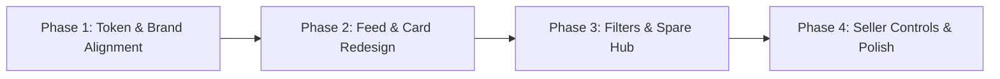

# LabMatrix Surplus Marketplace — Mobile Design System & Specification (`design.md`)

> **Document Purpose:** Comprehensive reverse-engineered mobile design specification for the **LabMatrix Surplus Marketplace** cross-platform app (`labmatrix_mobile`). This specification translates the established brand identity, product terminology, and B2B workflow of the live web platform (`https://surplus.labmatrixindia.com/`) into an implementation-ready mobile UI/UX system optimized for **Google Stitch** prompts and native React Native / Expo implementation.

---

## 1. Product Overview

### 1.1 Brand Identity & Operating Entity
* **Product Name:** LabMatrix Surplus Marketplace (*LabMatrix Market*)
* **Operating Entity:** Labmatrix Instrument India Pvt. Ltd.
* **Corporate Office:** 514/5, Mehrauli, New Delhi – 110030, India
* **Sales & Inquiries Desk:** `sales@labmatrixindia.com`
* **Live Website:** [https://surplus.labmatrixindia.com](https://surplus.labmatrixindia.com)

### 1.2 Core Value Proposition
LabMatrix Surplus Marketplace is a specialized B2B equipment liquidity platform for the Indian scientific, analytical, pharmaceutical, and biotechnology research sectors. Unlike general commercial e-commerce, LabMatrix facilitates the procurement, sale, and technical inspection of high-value analytical instruments (typically valued between ₹3 Lakh and ₹50+ Lakh) and tested replacement components.

### 1.3 Key Market Segments & Catalogs
The platform manages three primary catalog classifications:
1. **Available Equipment (`MACHINE`):** Certified pre-owned, refurbished, and surplus laboratory instruments (HPLC, GC-MS, AAS, ICP-OES, UV-Vis, FTIR, DSC-TGA, Dissolution Testers, Centrifuges).
2. **New Instruments (`NEW_INSTRUMENT`):** Turnkey analytical machinery, demo units, and factory-sealed instruments sold with OEM/vendor warranty.
3. **Spare Parts & Consumables (`SPARE_PART`):** Hard-to-source replacement electronic boards, power supplies, detector lamps, valves, and optical components cataloged with exact OEM Part Numbers and Instrument Compatibility tags.
4. **Buyer Sourcing Requirements (`REQUIREMENT` / RFQ):** Demand-side requests posted by labs and manufacturing facilities seeking specific models or boards.

### 1.4 Native Marketplace Workflow (Non-Cart B2B Model)
Analytical instruments require technical due diligence, operational logs, on-site/video inspection, and logistics handling. The marketplace therefore operates on an **Inquiry & Verification Workflow**, rather than an instant consumer checkout:
```
[Catalog Discovery & Search] 
          │
          ▼
[Technical Specification & Photo Inspection] 
          │
          ▼
[Direct Inquiry / Request Quote] ──► [LabMatrix Operations Verification]
          │                                        │
          ▼                                        ▼
[Lead Delivery to Inquirer & Seller] ──► [Inspection & Handover Escrow]
```

---

## 2. Repository Audit

### 2.1 Website Repository: `E:\projects\labmatrix_market`
* **Framework:** Next.js 16.4.0 (App Router, React 19.3.0, Turbopack)
* **Styling Engine:** Tailwind CSS v4 (`@tailwindcss/turbopack`) with `@theme` block in `src/app/globals.css`
* **Database & ORM:** PostgreSQL on Neon Serverless with Prisma ORM 7.10.0 (`@prisma/adapter-pg`)
* **Authentication:** NextAuth.js v5 (Beta 32) with bcrypt password encryption and 6-digit email OTPs
* **Key Visual Files Inspected:**
  * `src/app/globals.css`: Primary color variables (`--color-brand-blue: #033a7d`, `--color-brand-gold: #fbc634`)
  * `src/app/layout.tsx`: Geist Sans font integration, metadata, root preconnections
  * `src/components/layout/Navbar.tsx`: Desktop & mobile navigation, sticky header blur, PostActionMenu
  * `src/components/layout/PostActionMenu.tsx`: Brand Gold CTA button (`bg-brand-gold text-brand-blue font-black`)
  * `src/components/listings/ListingsClient.tsx`: 4:3 aspect cards, status badges, price ranges, price tier filters
  * `src/components/listings/SparePartsClient.tsx`: Dual-tab architecture (In Stock vs. Wanted Parts), part numbers
  * `src/components/listings/NewInstrumentsClient.tsx`: New instrument showcase with warranty badges
  * `src/components/inquiries/InquiryBox.tsx`: Contextual inquiry messaging, phone validation, success feedback
  * `src/app/listings/[id]/page.tsx`: Technical specifications layout, assurance box, breadcrumb hierarchy
  * `prisma/schema.prisma`: Data models (`User`, `Listing`, `Requirement`, `Inquiry`, `Notification`)

### 2.2 Mobile App Repository: `E:\projects\labmatrix_mobile`
* **Framework:** React Native 0.88.0, Expo SDK 58.0.19, Expo Router 58.0.26
* **State & Data Fetching:** `@tanstack/react-query` v5.x with Axios
* **Hardware Storage:** `expo-secure-store` for 30-day JWT token caching
* **Media:** `expo-image-picker` with Cloudinary multipart direct uploads
* **Icons:** `lucide-react-native` and `react-native-svg`
* **Build Profiles:** `eas.json` (preview APK, production AAB/IPA)
* **Key Files Inspected:**
  * `src/constants/theme.ts`: Boilerplate colors needing replacement with verified brand tokens
  * `src/lib/api.ts`: Central Axios client pointing to `https://surplus.labmatrixindia.com`
  * `src/app/(tabs)/_layout.tsx`: 5-tab bottom navigation (Marketplace, Requests, Sell, Inquiries, Profile)
  * `src/app/(tabs)/index.tsx`: Marketplace screen with search, type filter pills, and listing cards
  * `src/app/listing/[id].tsx`: Full equipment details, image slider, specs table, inquiry modal
  * `src/app/notifications.tsx`: In-app notification center with unread badges
  * `src/app/(auth)/login.tsx` & `register.tsx`: Complete mobile auth with 6-digit OTP verification

---

## 3. Source-of-Truth Rules

To ensure visual consistency and prevent arbitrary design choices:

1. **Brand Identity & Color Tokens:** `E:\projects\labmatrix_market` is the **exclusive source of truth** for colors, typography hierarchy, status semantics, and logo iconography.
2. **Product Terminology & Classifications:** Database models in `prisma/schema.prisma` and web filter chips determine valid categories, condition labels, item types (`MACHINE`, `NEW_INSTRUMENT`, `SPARE_PART`), and statuses (`AVAILABLE`, `PENDING`, `SOLD`, `OPEN`, `FULFILLED`, `CLOSED`). No invented classifications are permitted.
3. **Functional Scope & Mobile UX Constraints:** `E:\projects\labmatrix_mobile` defines the technical scope, native interaction model, navigation structure, and offline/caching behavior.
4. **Resolution Rule for Discrepancies:** If a website feature is not yet present on mobile (e.g., duplicate listing, filter bottom sheet), it is specified as a **Proposed Mobile Adaptation** grounded strictly in existing API endpoints, without inventing new backend requirements.

---

## 4. Existing Brand Identity

### 4.1 Color System (Verified Source: `src/app/globals.css`)

#### Primary Brand Blue (Deep Institutional Navy Sapphire)
Represents clinical precision, laboratory authority, and high-value equipment trust.
* `brand-blue-50`: `#eff5fb` *(Card tints, tag backgrounds, category chip hover)*
* `brand-blue-100`: `#dbeaf7` *(Border highlights, subtle divider lines)*
* `brand-blue-200`: `#bcd9f0` *(Card active borders, secondary badge strokes)*
* `brand-blue-300`: `#8bbce3` *(Decorative illustrations, subtle iconography)*
* `brand-blue-400`: `#549cd4` *(Interactive link states)*
* `brand-blue-500`: `#084b9e` *(Hover state for primary buttons)*
* **`brand-blue-600` / Primary Base:** **`#033a7d`** *(Main brand identity, headers, primary buttons, price tags)*
* `brand-blue-700`: `#022f66` *(Pressed state on mobile buttons)*
* `brand-blue-800`: `#02244e` *(Assurance box borders)*
* `brand-blue-900`: `#011936` *(Photo category overlay badges, dark hero sections)*
* `brand-blue-950`: `#010f22` *(Marketplace assurance container background)*

#### Brand Accent Gold (Technical Golden Amber)
Used for calls to action, high-priority conversion buttons, and verified inspection tags.
* `brand-gold-50`: `#fef9e7` *(Verified checkmark backgrounds, alert banner tints)*
* `brand-gold-100`: `#fdf2ca` *(Warning tag strokes, verified pill strokes)*
* `brand-gold-200`: `#fce497` *(Subtle badge highlights)*
* `brand-gold-300`: `#fbd364` *(Hover state for CTA buttons)*
* **`brand-gold-400` / Accent Base:** **`#fbc634`** *(Post/Sell button, highlight badges, star ratings)*
* `brand-gold-500`: `#f0b01c` *(Pressed state on mobile CTA buttons)*
* `brand-gold-600`: `#d49a08` *(Checkmark icons, technical inspection indicators)*
* `brand-gold-700`: `#a97505` *(Text on gold badges for accessibility)*
* `brand-gold-800`: `#885c0a` *(Dark gold text on light gold pills)*
* `brand-gold-900`: `#714c0c` *(Borders on dark gold tags)*

#### Neutral Canvas & Surface System
* `canvas-bg`: `#f8fafc` *(Slate-50 — Clean medical off-white background)*
* `surface-white`: `#ffffff` *(Card backgrounds, modals, input fields)*
* `border-subtle`: `#e2e8f0` *(Slate-200 — 1px container and card outlines)*
* `border-input`: `#cbd5e1` *(Slate-300 — Input borders, inactive filter pills)*
* `text-primary`: `#0f172a` *(Slate-900 — Headings, titles, high-contrast values)*
* `text-secondary`: `#475569` *(Slate-600 — Body copy, field labels, metadata)*
* `text-muted`: `#64748b` *(Slate-500 — Captions, timestamps, placeholder text)*
* `text-disabled`: `#94a3b8` *(Slate-400 — Disabled state text, empty state icons)*

#### Semantic Status Tokens (Verified Source: `ListingsClient.tsx` & `page.tsx`)
* **Available / In Stock:** 
  * Background: `#dcfce7` (Green-100) | Text: `#15803d` (Green-700) | Pulse: `#22c55e`
* **Sold Out (Realized):**
  * Pill Background: `#0f172a` (Slate-900) | Text: `#ffffff` | Dot: `#f43f5e` (Rose-500)
  * Secondary Banner: Background: `#fef3c7` (Amber-100) | Text: `#78350f` (Amber-900)
  * Card Image Treatment: Grayscale 40% with 90% opacity
* **Pending Moderation (Owner/Admin Only):**
  * Background: `#fef3c7` (Amber-100) | Border: `#fde68a` | Text: `#92400e` (Amber-800)
* **Item Classification Badges:**
  * Pre-Owned (`MACHINE`): Background: `#eff5fb` | Text: `#033a7d` (Brand Blue)
  * Brand New (`NEW_INSTRUMENT`): Background: `#dcfce7` | Text: `#15803d` (Emerald)
  * Spare Part (`SPARE_PART`): Background: `#fef9e7` | Text: `#b45309` (Amber)

---

### 4.2 Typography Hierarchy

* **Primary Typeface:** Geist Sans (Web) ➔ Native Mapping: **SF Pro Display / Text** (iOS) and **Roboto** (Android).
* **Code / Part Number Typeface:** ui-monospace / SFMono / Courier New for OEM catalog codes.

| Level | Size (pt) | Line Height | Weight | Tracking | Usage & Verified Source |
| :--- | :--- | :--- | :--- | :--- | :--- |
| **Display Header** | 28 | 34 | 900 (Black) | -0.5px | Hero header, major screen titles |
| **Screen Title (H1)** | 22 | 28 | 800 (ExtraBold) | -0.3px | Product detail titles, screen top bars |
| **Card Heading (H2)** | 16 | 22 | 700 (Bold) | -0.2px | Listing card titles (line-clamp-2) |
| **Section Header (H3)**| 14 | 18 | 700 (Bold) | 0.5px (Caps)| Spec box headers, group dividers |
| **Price Hero** | 22 | 26 | 900 (Black) | 0px | Listing detail price (`text-brand-blue`) |
| **Card Price** | 16 | 20 | 800 (ExtraBold) | 0px | Listing feed expected price in INR |
| **Body Primary** | 14 | 20 | 500 (Medium) | 0px | Technical descriptions, input values |
| **Body Secondary** | 13 | 18 | 400 (Regular) | 0px | Card descriptions, subtitle hints |
| **Field Label** | 13 | 16 | 600 (SemiBold) | 0px | Form labels, specification labels |
| **Metadata / Badge** | 11 | 14 | 700 (Bold) | 0.4px (Caps)| Location, condition tag, date listed |
| **Micro Caption** | 10 | 12 | 700 (Bold) | 0.5px (Caps)| Over-image category badges, stock qty |

---

### 4.3 Verified Product Terminology & Options

#### Analytical Categories (Verified Source: `ListingsClient.tsx` & `page.tsx`)
1. `HPLC & UHPLC` *(High-Performance Liquid Chromatography)*
2. `GC & GC-MS` *(Gas Chromatography - Mass Spectrometry)*
3. `UV-Vis & FTIR` *(Spectrophotometers & Fourier-Transform Infrared)*
4. `AAS` *(Atomic Absorption Spectrophotometers)*
5. `ICP-OES & ICP-MS` *(Inductively Coupled Plasma Optical Emission)*
6. `DSC-TGA & DMA` *(Thermal Analyzers)*
7. `Dissolution Testers`
8. `Stability Chambers`
9. `Particle Analyzers`
10. `Centrifuges & Shakers`
11. `Karl Fischer & Titrators`
12. `Spare Parts & Consumables`
13. `Other Lab Equipment`

#### Verified Condition Options (Source: `src/app/listings/create/page.tsx`)
* **For Equipment (`MACHINE`):**
  * `Used - Excellent (Calibrated)`
  * `Used - Good Working Condition`
  * `Used - Normal Wear`
  * `Refurbished by OEM/Third-Party`
  * `For Parts / Non-operational`
* **For New Instruments (`NEW_INSTRUMENT`):**
  * `Brand New - Factory Sealed`
  * `Brand New - Demo Unit`
  * `Brand New with OEM Warranty`
* **For Spare Parts (`SPARE_PART`):**
  * `Brand New - Sealed OEM`
  * `Tested Working Surplus`
  * `Used - Functional`
  * `Refurbished / Repaired`

#### Budget Filter Tiers (Verified Source: `ListingsClient.tsx`)
* `All Prices` (Unrestricted)
* `Under ₹3 Lakh` (`max: 300000`)
* `₹3L - ₹8 Lakh` (`min: 300000, max: 800000`)
* `₹8L - ₹20 Lakh` (`min: 800000, max: 2000000`)
* `₹20 Lakh+` (`min: 2000000`)

---

## 5. Consolidated Design Tokens

```typescript
// Proposed Mobile Design Tokens derived from E:\projects\labmatrix_market\src\app\globals.css
export const LabMatrixTokens = {
  colors: {
    brand: {
      blue: '#033a7d',          // Primary interactive & brand base
      blue50: '#eff5fb',        // Chip background & card highlights
      blue100: '#dbeaf7',       // Active pill border
      blue500: '#084b9e',       // Pressed button state
      blue900: '#011936',       // Image overlay chip
      blue950: '#010f22',       // Dark assurance banner background
      gold: '#fbc634',          // Primary conversion CTA (Post/Sell)
      gold50: '#fef9e7',        // Verified banner & rating tint
      gold100: '#fdf2ca',       // Verified pill outline
      gold300: '#fbd364',       // Gold button hover/highlight
      gold500: '#f0b01c',       // Gold button pressed state
      gold700: '#a97505',       // Dark gold text
    },
    surface: {
      canvas: '#f8fafc',        // Main app background
      card: '#ffffff',          // Elevated card background
      input: '#ffffff',         // Text input background
      border: '#e2e8f0',        // Subtle card border
      borderInput: '#cbd5e1',   // Input field border
      darkCard: '#0f172a',      // Dark mode / dark section card
      darkBorder: '#1e293b',    // Dark mode border
    },
    text: {
      primary: '#0f172a',       // Slate-900 primary high contrast
      secondary: '#475569',     // Slate-600 body copy
      muted: '#64748b',         // Slate-500 captions & labels
      inverted: '#ffffff',      // Text on dark/blue surfaces
      accentGold: '#78350f',    // Text on gold backgrounds
    },
    semantic: {
      availableBg: '#dcfce7',
      availableText: '#15803d',
      soldPillBg: '#0f172a',
      soldPillText: '#ffffff',
      soldPulseDot: '#f43f5e',
      warningBg: '#fef3c7',
      warningText: '#92400e',
      errorBg: '#fee2e2',
      errorText: '#b91c1c',
    }
  },
  spacing: {
    xxs: 2,
    xs: 4,
    sm: 8,
    md: 12,
    lg: 16,
    xl: 20,
    xxl: 24,
    xxxl: 32,
  },
  radii: {
    sm: 6,                     // Badges, micro tags
    md: 10,                    // Buttons, input fields
    lg: 14,                    // Listing cards
    xl: 18,                    // Modals, action sheets
    full: 9999,                // Filter pills, avatar circles
  },
  aspectRatio: {
    cardThumbnail: 4 / 3,      // Matches web aspect-[4/3]
    detailCarousel: 16 / 10,   // Responsive mobile hero slider
  },
  elevation: {
    subtle: {
      shadowColor: '#0f172a',
      shadowOffset: { width: 0, height: 1 },
      shadowOpacity: 0.05,
      shadowRadius: 2,
      elevation: 1,
    },
    card: {
      shadowColor: '#0f172a',
      shadowOffset: { width: 0, height: 2 },
      shadowOpacity: 0.08,
      shadowRadius: 6,
      elevation: 2,
    },
    modal: {
      shadowColor: '#0f172a',
      shadowOffset: { width: 0, height: -3 },
      shadowOpacity: 0.15,
      shadowRadius: 12,
      elevation: 8,
    }
  }
} as const;
```

---

## 6. Mobile Information Architecture

### 6.1 Navigation Structure
The mobile app utilizes a **5-Tab Persistent Bottom Navigation** combined with a **Native Stack** for detail views and modal overlays:

```
Root Stack Navigator (expo-router)
│
├── (tabs) [Main App Shell with Persistent Bottom Navigation]
│   ├── index.tsx         ➔ Tab 1: Marketplace (Browse, Search, Filter Equipment & Parts)
│   ├── requests.tsx      ➔ Tab 2: Requests (Buyer Sourcing RFQs)
│   ├── sell.tsx          ➔ Tab 3: Sell (Post Equipment or Spare Part)
│   ├── inquiries.tsx     ➔ Tab 4: Inquiries (Received & Sent B2B Leads)
│   └── profile.tsx       ➔ Tab 5: Profile (Dashboard, Account Stats, Settings)
│
├── listing/[id].tsx      ➔ Stack Push: Equipment & Spare Part Details View
├── requests/[id].tsx     ➔ Stack Push: Sourcing Requirement Details & Offer Proposal
├── notifications.tsx     ➔ Stack Push: Notification Center (Bell Icon shortcut)
│
└── (auth) [Presentation: Modal / Bottom Sheet]
    ├── login.tsx         ➔ Sign In with Email & Password
    ├── register.tsx      ➔ Registration with 6-Digit Email OTP
    └── forgot-password.tsx➔ Password Reset with 6-Digit Email OTP
```

### 6.2 Verified User Journeys

#### Journey 1: Buyer Instrument Discovery & Inquiry
1. User lands on **Marketplace (Tab 1)** ➔ Views featured analytical instruments.
2. User selects filter pill `Pre-Owned` or types `"Waters HPLC"` into top search.
3. User taps a listing card (e.g. *"Waters 2695 Alliance HPLC"*) ➔ Navigates to `listing/[id]`.
4. User swipes through 4:3 photo gallery, reviews location (`"Mumbai"`), condition (`"Used - Good"`), and technical description.
5. User taps sticky bottom bar button: **"Send Inquiry / Request Quote"**.
6. Inquiry modal slides up ➔ Pre-fills verified user contact details ➔ User adds technical questions ➔ Taps **"Submit Inquiry"**.
7. Inquiry logs in backend (`/api/inquiries`) ➔ App displays green confirmation badge.

#### Journey 2: Laboratory Technician Selling Equipment
1. User taps **Sell (Tab 3)** in bottom bar.
2. If unauthenticated, modal prompts login; if authenticated, multi-step form opens.
3. User selects classification toggle: `Pre-Owned Instrument`.
4. User taps **"Add Photo"** ➔ Native camera or gallery opens ➔ Image uploads to Cloudinary with progress indicator.
5. User enters title, selects category (`Clinical Chemistry`), condition, price expectation, and city.
6. User taps **"Submit Listing for Review"**.
7. Success alert notifies user: *"Listing submitted for admin moderation. You will receive an in-app alert when approved."*

#### Journey 3: Sourcing Hard-to-Find Spare Parts
1. User taps **Requests (Tab 2)** ➔ Browses open buyer RFQs.
2. Or searches for a part number (e.g., `"PerkinElmer PPC Module"`).
3. If an open requirement matches inventory the user owns, user taps **"I Have This Equipment (Fulfill Request)"**.
4. User submits proposal with unit condition and expected price ➔ Delivered directly to the requesting lab.

---

## 7. Screen Inventory & Status

| Screen Identifier | Route | Screen Purpose | Status | Action Required |
| :--- | :--- | :--- | :--- | :--- |
| **SCR-01** | `(tabs)/index` | Marketplace Catalog & Search | **Needs Redesign** | Apply `#033a7d` branding, category bottom sheet, shimmer skeleton, sold status indicator |
| **SCR-02** | `(tabs)/requests` | Buyer Sourcing Requirements (RFQs) | **Needs Redesign** | Align card layout, status pill styling, and category filters |
| **SCR-03** | `(tabs)/sell` | Post Equipment or Spare Part Form | **Needs Redesign** | Implement Brand Gold CTA, multi-step progress, condition pickers matching web |
| **SCR-04** | `(tabs)/inquiries`| Inquiries & Lead Management | **Needs Redesign** | Segmented tabs, contact card styling, lead status badges |
| **SCR-05** | `(tabs)/profile` | User Dashboard & Account Actions | **Needs Redesign** | Profile summary, my items count, account deletion modal compliance |
| **SCR-06** | `listing/[id]` | Instrument & Spare Details View | **Needs Redesign** | 16:10 carousel, spec table, sold banner with 'Request Similar', sticky inquiry bar |
| **SCR-07** | `requests/[id]` | Requirement Details & Proposal View | **Needs Redesign** | Spec box, buyer details shielding, proposal submission bottom sheet |
| **SCR-08** | `notifications` | In-App Notification Center | **Existing** | Polish unread badges, timestamp formatting, mark-all-read button |
| **SCR-09** | `(auth)/login` | Sign In Screen | **Needs Redesign** | Branded logo header, floating input borders, forgot password link |
| **SCR-10** | `(auth)/register` | Account Creation with OTP | **Needs Redesign** | OTP input boxes (6-cell pin layout), company/phone fields |
| **SCR-11** | `(auth)/forgot-password` | Password Reset Flow | **Existing** | Polish step 1 (email) and step 2 (OTP + new password) transitions |
| **SCR-12** *(Proposed)* | `filters` (Modal) | Multi-Dimensional Filter Sheet | **Missing but Required**| Category picker, price range sliders, condition checkboxes |
| **SCR-13** *(Proposed)* | `listing/[id]/edit` | Seller Edit & Status Toggle | **Missing but Required**| Mark as SOLD toggle, price edit, duplicate listing button |

---

## 8. Screen-by-Screen Specifications

### 8.1 Screen SCR-01: Marketplace Home Feed (`(tabs)/index.tsx`)
* **Primary Intent:** Discover, filter, and inspect certified laboratory machinery and tested components.
* **Header Bar (Sticky):**
  * Left: Brand logo image (`/logo.png`) or high-contrast typography *"LabMatrix Market"*.
  * Right: Notification Bell icon with unread red badge (`notifications.tsx`).
* **Search & Filter Component:**
  * Top input: Rounded search bar (`border-slate-200 bg-slate-50`), magnifying glass icon (`#64748b`), placeholder *"Search HPLC, GC-MS, part numbers..."*.
  * Filter button: SlidersHorizontal icon opening the proposed **Filter Sheet (SCR-12)**.
* **Classification Horizontal Chips:**
  * `All Items` (`ALL`)
  * `Pre-Owned` (`MACHINE`)
  * `Brand New` (`NEW_INSTRUMENT`)
  * `Spare Parts` (`SPARE_PART`)
  * Active chip: `bg-brand-blue text-white font-bold shadow-xs`.
  * Inactive chip: `bg-slate-100 text-slate-600 font-semibold border border-slate-200`.
* **Listing Card Layout (Vertical Feed):**
  * Container: `bg-white rounded-2xl border border-slate-200 shadow-xs overflow-hidden`.
  * Image Thumbnail: `aspect-[4/3]` with Cloudinary optimization.
  * Over-Image Badges:
    * Top Left: Category badge (`bg-brand-blue-900/85 text-white font-bold text-[10px] px-2 py-0.5 rounded`).
    * Top Right: If sold, `bg-slate-900/90 text-white` with pulsing red dot (`#f43f5e`) *"Sold Out"*.
  * Card Body:
    * Condition badge (`bg-brand-blue-50 text-brand-blue font-semibold text-[11px] px-2 py-0.5 rounded`).
    * Item Title: 2 lines clamped, bold 16pt, `#0f172a`.
    * Expected Price: Large 16pt ExtraBold in `#033a7d` (`₹{min.toLocaleString('en-IN')}`).
    * Footer Row: Location with MapPin icon (`"Mumbai"`) and action button (`"Inquire"` with external link icon).
* **States:**
  * Loading: Shimmer skeleton cards (3 cards with pulsing 4:3 image and skeleton lines).
  * Empty: Search icon in circular container with *"No equipment found matching filters"*, *"Reset Filters"* button.
  * Error: Red alert box with Retry button.

---

### 8.2 Screen SCR-06: Instrument Details Screen (`listing/[id].tsx`)
* **Primary Intent:** Evaluate technical condition, verified specs, and submit a quote request.
* **Top Gallery Slider:**
  * 16:10 aspect ratio image carousel with swipe gestures and bottom pagination dots (`#033a7d` active, `#cbd5e1` inactive).
* **Header Block:**
  * Category breadcrumb: Uppercase bold 11pt `#033a7d`.
  * Title: 22pt ExtraBold `#0f172a`.
  * Price Box: `₹{minPrice.toLocaleString('en-IN')} - ₹{maxPrice.toLocaleString('en-IN')}` with subtitle *"Approximate Price Expectation • Subject to Inspection"*.
  * Badges Row: Condition (`"Used - Excellent"`), Location (`"Hyderabad, Telangana"`), Listed Date.
* **SOLD OUT Handling (If `status === "SOLD"`):**
  * Visual Treatment: Amber alert box (`bg-amber-50 border border-amber-200`).
  * Copy: *"Item Sold Out • Looking for this model? LabMatrix actively sources certified units. Post a sourcing request to get notified."*
  * Secondary CTA: *"Post Sourcing Request"* in Brand Navy.
* **Technical Specifications Box:**
  * Container: `bg-slate-50 border border-slate-200 rounded-xl p-4`.
  * Key-Value Grid:
    * `Category`: HPLC & UHPLC
    * `Item Classification`: Analytical Equipment
    * `Quantity Available`: 1 Unit
    * `Part / Catalog #`: (If spare part) Mono font
    * `Compatible Instrument`: (If spare part) e.g., *"Waters Alliance 2695"*
* **Marketplace Assurance Box:**
  * Dark navy box (`bg-brand-blue-950 border border-brand-blue-800 text-white rounded-xl p-4`).
  * ShieldCheck icon in gold (`#fbc634`).
  * Copy: *"Verified Equipment Listing • Specifications and operational logs verified. On-site or video technical inspection coordinated."*
* **Sticky Bottom Action Bar:**
  * Full width elevated bar with safe area inset.
  * Primary Action: **"Send Inquiry / Request Quote"** button (`bg-brand-blue text-white font-bold h-12 rounded-xl`).
  * Tapping opens **Inquiry Bottom Sheet Modal**.

---

### 8.3 Screen SCR-03: Sell Equipment / Post Item (`(tabs)/sell.tsx`)
* **Primary Intent:** Submit an instrument or spare part for technical review and marketplace listing.
* **Item Classification Segmented Control:**
  * 3 tabs: `Pre-Owned Instrument` | `Brand New` | `Spare Part`.
  * Selected state: White card with subtle shadow, text in Brand Navy.
* **Photo Upload Section:**
  * Horizontal scroll of uploaded photo thumbnails with top-right delete icon (`X`).
  * `Add Photo` button: Dashed 1.5px border in Brand Navy, light blue fill (`#eff5fb`), camera icon, label *"Add Photo (Max 5MB)"*.
* **Form Fields (Floating Label Style):**
  * `Item Title *`: e.g. *"Agilent 1260 Infinity II Quaternary HPLC"*
  * `Category *`: Horizontal pill scroll of verified analytical categories.
  * `Condition *`: Radio chip selector of verified condition options.
  * `Part Number`: (Visible only if `Spare Part` is selected)
  * `Compatible Instrument`: (Visible only if `Spare Part` is selected)
  * `Price Expectation (₹)`: Dual fields for Min Price and Max Price.
  * `Location / City *`: City and State.
  * `Technical Description *`: Multi-line text area (min 10 characters).
* **Primary Action:**
  * Sticky button: **"Submit Listing for Review"** in Brand Gold (`bg-brand-gold text-brand-blue font-black h-12 rounded-xl`).
  * Subtext: *"Items undergo admin verification before going live on the marketplace."*

---

### 8.4 Screen SCR-04: Inquiries & Leads Management (`(tabs)/inquiries.tsx`)
* **Primary Intent:** Track buyer inquiries and negotiate equipment quotations.
* **Top Segmented Navigation:**
  * `Received Leads ({count})`: Inquiries sent by buyers on items you listed.
  * `Sent Inquiries ({count})`: Quotations you requested on marketplace items.
* **Inquiry Card Component:**
  * Header: Item Title in bold 15pt, status pill (`NEW`, `IN_PROGRESS`, `CLOSED`).
  * Message Quote: Italics slate text *"I am interested in acquiring this HPLC system..."*.
  * Inquirer Contact Box: Light slate rounded container displaying verified Name, Phone, Email, and Company.
  * Action Buttons: One-tap **"Call Buyer"** (opens phone dialer) and **"Email Buyer"** (opens email client).
  * Timestamp: Right-aligned date listed.

---

### 8.5 Screen SCR-05: User Profile & Account Management (`(tabs)/profile.tsx`)
* **Primary Intent:** View account status, manage inventory, and account security.
* **Profile Header:**
  * User avatar with Brand Navy circle background.
  * Full Name and Email.
  * Verified Account Badge: `ShieldCheck` icon with label `VERIFIED USER` or `ADMIN ACCOUNT`.
* **Activity Metrics Summary (2-Col Grid):**
  * `Listings`: Total items posted by user.
  * `Requests`: Total equipment RFQs posted.
* **Account Details Section:**
  * Registered Phone Number, Organization / Diagnostic Lab Name.
* **Account Actions:**
  * Sign Out button (`bg-rose-50 text-rose-700 font-bold`).
  * **"Delete Account"** option: Triggers confirmation dialog explaining data erasure, required by Apple App Store guidelines.

---

### 8.6 Screen SCR-07: Equipment Requirement Details (`requests/[id].tsx`)
* **Primary Intent:** Inspect buyer requirements and submit an equipment supply proposal.
* **Layout:**
  * Category badge (`#033a7d`), Status badge (`OPEN` in green, `FULFILLED` in gray).
  * Requirement Title (e.g. *"Wanted: PerkinElmer Optima 8300 ICP-OES"*).
  * Date posted and verified buyer tag (buyer contact details shielded for privacy).
  * Specifications Box: Desired configuration, detector type, and compatibility.
* **Action:**
  * Sticky Bottom Button: **"I Have This Equipment (Fulfill Request)"** in Brand Navy.
  * Opens Proposal Modal allowing seller to specify unit condition, testing logs, and quote price.

---

### 8.7 Screen SCR-10: Mobile Registration with OTP (`(auth)/register.tsx`)
* **Primary Intent:** Register a verified B2B laboratory account.
* **Layout & Stepper Flow:**
  * Step 1: Name, Email Address, Password, Phone Number, Company / Diagnostic Lab Name.
  * Action: **"Send Email Verification Code"** button.
  * Step 2: 6-digit numeric OTP code input boxes with countdown timer.
  * Action: **"Verify & Create Account"** button in Brand Navy.

---

## 9. Reusable Component Library (Mobile)

### 9.1 Button System

```
[Button: Primary Action]
- Background: #033a7d (Brand Navy)
- Text: #ffffff | 15pt Bold
- Height: 48dp | Radius: 10dp
- Pressed: #022f66

[Button: Conversion CTA (Post/Sell)]
- Background: #fbc634 (Brand Gold)
- Text: #033a7d (Brand Navy) | 15pt ExtraBold / Black
- Height: 48dp | Radius: 10dp
- Pressed: #f0b01c

[Button: Secondary / Outline]
- Background: transparent | Border: 1px #cbd5e1
- Text: #0f172a | 14pt SemiBold
- Height: 44dp | Radius: 10dp

[Button: Destructive / Delete]
- Background: #fee2e2 | Border: 1px #fca5a5
- Text: #dc2626 | 14pt Bold
- Height: 44dp | Radius: 10dp
```

### 9.2 Status & Category Pill Badges
* **Category Badge:** `bg-[#eff5fb] text-[#033a7d] border border-[#dbeaf7] rounded-md px-2 py-0.5 text-[10px] font-bold uppercase`
* **Available Badge:** `bg-[#dcfce7] text-[#15803d] rounded-md px-2 py-0.5 text-[11px] font-bold`
* **Sold Out Badge:** `bg-[#0f172a] text-[#ffffff] rounded-full px-2.5 py-0.5 text-[10px] font-bold uppercase` with red pulsing dot
* **Quantity Badge:** `bg-[#f59e0b] text-[#ffffff] rounded-md px-1.5 py-0.5 text-[10px] font-bold`

### 9.3 Product Card Container
* `aspectRatio: 4 / 3` image header with Cloudinary auto-format.
* 1px border `#e2e8f0` with 14dp radius and subtle elevation shadow.
* Padding: 14dp content body with high-contrast text and location metadata.

### 9.4 Shimmer Skeleton Loaders
* Rectangular skeleton with linear gradient animated pulse from `#e2e8f0` to `#f1f5f9`.
* Pre-configured dimensions: Card Skeleton (4:3 image + 3 text bars), Detail Hero Skeleton.

---

## 10. Interaction and Accessibility Guidelines

1. **Touch Targets:** All interactive components (buttons, filter chips, navigation tabs, modal close triggers) must adhere to a minimum touch bounding box of **48 × 48 dp**.
2. **Color Contrast (WCAG 2.1 AA Compliance):**
   * Primary Navy (`#033a7d`) on white background achieves a contrast ratio of **9.8:1** (exceeds AAA requirement of 7:1).
   * Brand Gold (`#fbc634`) must always be paired with dark navy text (`#033a7d` or `#010f22`), achieving **8.5:1** contrast. White text on Brand Gold is strictly prohibited.
3. **Safe Area Insets:** Screen layouts must explicitly incorporate top notch/dynamic island insets and bottom gesture pill insets via `react-native-safe-area-context`.
4. **Keyboard Management:** Forms in `sell.tsx`, `register.tsx`, and `inquiries` must be wrapped in `KeyboardAvoidingView` with automatic scroll-to-active-input behavior.
5. **Numeric Keyboards:** Price range, quantity, phone number, and OTP inputs must explicitly declare `keyboardType="numeric"` or `keyboardType="phone-pad"`.

---

## 11. Website-to-Mobile Adaptations

| # | Desktop Website Pattern | Why It Must Change on Mobile | Recommended Mobile Pattern | Reused Design Tokens |
| :- | :--- | :--- | :--- | :--- |
| **1** | Top multi-item navigation bar with dropdown menus (`Navbar.tsx`) | Desktop navigation spans 1200px; cannot fit in 390px viewport | 5-Tab persistent Bottom Navigation with fixed height 60dp | `--color-brand-blue` (`#033a7d`), `text-slate-600` |
| **2** | Side-by-side split screen (Left: Photos, Right: Sticky Price & Inquiry Box) | Narrow screens lack horizontal room for 2-column layouts | Single vertical flow: 16:10 Image Slider ➔ Specifications Box ➔ Sticky bottom action bar for Inquiry | `aspect-[4/3]`, `bg-brand-blue-950`, `bg-white` |
| **3** | Inline horizontal scroll of 13 category buttons + 5 price buttons | Desktop scrollbars look cluttered and wrap uncomfortably | 4 high-level classification pills on feed + dedicated **Filter Bottom Sheet Modal** | `bg-brand-blue-50`, `bg-brand-blue`, `border-slate-200` |
| **4** | Desktop multi-file drag-and-drop image upload zone | Mobile users upload directly from device camera or camera roll | Native camera / photo picker grid with square thumbnail previews & delete badges | `border-dashed`, `#eff5fb`, `text-brand-blue` |
| **5** | Right-hand static inquiry form on every product page | Consumes 400px of vertical space before user can see other info | Sticky 48dp bottom button opening a smooth slide-up **Inquiry Action Sheet** | `bg-brand-blue`, `text-white`, `radii.xl (18dp)` |

---

## 12. Google Stitch Design Instructions

### 12.1 Visual Prompting Direction
When generating screens in Google Stitch (Standard or Experimental Sketch-to-UI mode), use these core principles:
1. **Domain Tone:** Clean, clinical, high-precision laboratory engineering. Not playful consumer retail.
2. **Primary Palette:** Always specify `#033a7d` as the dominant brand navy, `#fbc634` as the action gold, and `#f8fafc` as the background canvas.
3. **Card Density:** Instrument cards must look like technical specification sheets with condition, model numbers, and INR prices.

### 12.2 First Screen to Design in Google Stitch
**Design SCR-01 (Marketplace Home Feed) First.**  
*Rationale:* The Marketplace feed establishes the universal navigation bar, search bar elevation, filter pill states, instrument card aspect ratios, condition badges, and price formatting. Once SCR-01 is finalized, all other screens inherit its component tokens directly.

### 12.3 Exact Google Stitch Prompt Templates

#### Prompt: Screen SCR-01 (Marketplace Feed)
```
Design a high-precision B2B mobile marketplace home screen for laboratory and analytical instruments (HPLC, GC-MS, Spectrometers).
- Canvas: iPhone 16 / Android, Background: #f8fafc (clean clinical off-white).
- Top Bar: Header title "LabMatrix Market" in bold navy #033a7d, with a subtle notification bell icon on the right.
- Search Bar: Rounded input field in #f1f5f9 with magnifying glass icon and placeholder "Search instruments, models, part numbers...".
- Filter Chips: Horizontal scrolling pill chips: "All Items" (active: navy #033a7d background with white text), "Pre-Owned", "Brand New", "Spare Parts" (inactive: slate-100 background with dark slate text).
- Product Feed: Vertical list of laboratory instrument cards. Each card has a 4:3 aspect ratio photo of an analytical machine, rounded corners (14px), thin border (#e2e8f0), top-left category badge ("HPLC & UHPLC" in navy #011936 with white text), condition tag ("Used - Excellent" in light blue #eff5fb), bold title ("Waters 2695 Alliance HPLC System"), expected price in Indian Rupees ("₹4,50,000" in bold navy #033a7d), and city tag with pin icon ("Mumbai").
- Bottom Navigation Bar: 5 tab icons with labels: Marketplace (active: blue store icon), Requests (clipboard), Sell (plus circle in gold #fbc634), Inquiries (message), Profile (user).
```

#### Prompt: Screen SCR-06 (Instrument Details)
```
Design a mobile product detail screen for a laboratory instrument on LabMatrix Market.
- Colors: Primary navy #033a7d, gold accent #fbc634, background #ffffff.
- Top: Swipable photo carousel showing high-resolution instrument angles with pagination dots.
- Info: Category subtitle "Clinical Chemistry", Instrument Title "Roche Cobas c311 Analyzer" in large bold 22pt text.
- Price: "₹8,50,000 - ₹11,00,000" in extra bold navy with subtext "Approximate Price Expectation".
- Badges: "Used - Good Working Condition" and "Qty: 1 available".
- Specifications Card: Light gray container (#f8fafc) with key-value table: Category, Condition, Location (New Delhi), Listed Date.
- Assurance Banner: Dark navy container (#010f22) with gold shield icon and text "Verified Laboratory Equipment • Tested inspection coordinated".
- Bottom Action Bar: Persistent sticky white bar with a prominent full-width button: "Send Inquiry / Request Quote" in navy blue #033a7d with white text and send icon.
```

---

## 13. Open Questions & Unknowns

The following product decisions require operational alignment with the LabMatrix team:
1. **Direct WhatsApp vs. In-App Inquiry:** The web platform routes all leads through `/api/inquiries` and admin notifications to `sales@labmatrixindia.com`. Should the mobile app also provide a direct WhatsApp CTA button for urgent instrument sourcing, or should it preserve central inquiry logging?
2. **Guest Inquiries:** Currently, both web and mobile require user authentication before sending inquiries to prevent spam. Should verified guest inquiries with mobile OTP verification be supported to reduce drop-off?
3. **Biometric Authentication:** Should `expo-local-authentication` (FaceID / Fingerprint) be enabled to unlock cached sessions without re-entering credentials?

---

## 14. Prioritized UI/UX Implementation Plan



### Phase 1: Token & Brand Alignment (Days 1–2)
* Update `theme.ts` in `labmatrix_mobile` to export `LabMatrixTokens` (`#033a7d`, `#fbc634`, `#f8fafc`).
* Replace all hardcoded `#0284c7` instances across buttons, tabs, and headers with verified Brand Navy and Brand Gold tokens.
* Standardize 48dp touch targets and typography weights across navigation bars.

### Phase 2: Marketplace Feed & Product Detail Redesign (Days 3–5)
* Implement the redesigned 4:3 `ListingCard` with Qty badge, Sold Out overlay, and en-IN rupee formatting.
* Build the `aspect-[16/10]` image carousel and technical spec table in `listing/[id].tsx`.
* Add shimmering skeleton cards during initial API query execution.

### Phase 3: Filter Bottom Sheet & Spare Parts Dual Tabs (Days 6–7)
* Build the proposed `FilterSheet` modal supporting category selection and budget tier checkboxes.
* Implement the Spare Parts dedicated view with OEM Part Number and Instrument Compatibility highlighting.

### Phase 4: Seller Management & Store Polish (Days 8–9)
* Implement seller listing management (Toggle Sold status, Duplicate Listing).
* Finalize asset icons (`icon.png`, `splash.png`) with verified `#033a7d` background.
* Execute final `eas build -p all` for Google Play and TestFlight submission.
